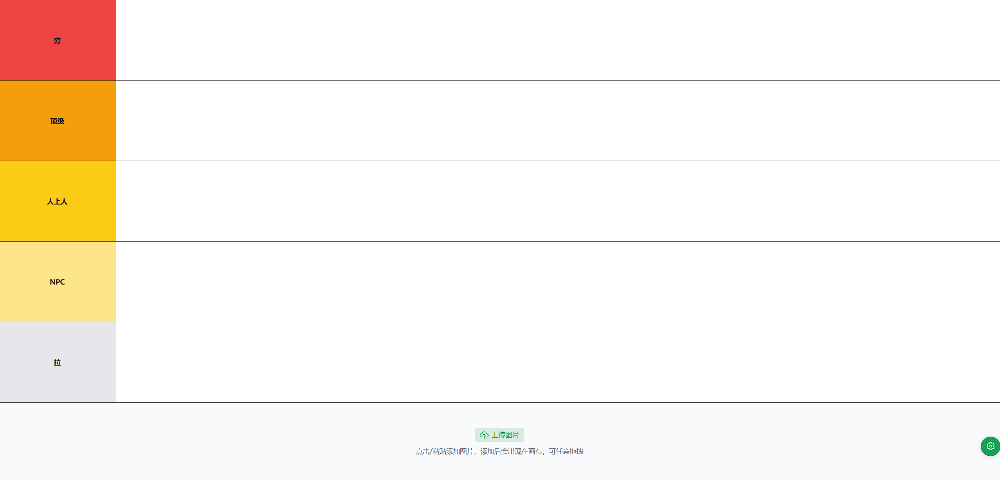

# HangOrLa



## 背景介绍

“从夯到拉”是一个网络流行语，表示一种新的评价体系，通常将事物分为夯、顶级、人上人、NPC、拉完了等五个等级，夯代表最优秀的状态。

该梗起源于网络，通过视频等形式在中国网络上迅速传播。其分级体系为：

- **夯**：代表事物的极致优秀状态，超越常规评价标准。
- **顶级**：非常优秀，但略逊于“夯”。
- **人上人**：比普通人更优秀的存在。
- **NPC**：指中规中矩的人，表现平平。
- **拉完了**：表示最低级别，通常指表现极差的状态。

这一评价体系被广泛应用于多个领域，包括游戏角色强度分析、武器排名、时尚品牌评价等。它反映了网络文化中对事物评价的多样性和个性化，成为一种新的表达方式。

## ✨ 功能

首次访问会展示内置的美食排行示例，可以直接拖动图卡或点击图库图片体验摆放。右上角的清空图标在悬停或键盘聚焦时展开“清空全部”文字，经确认后清除榜单和图库图片，保留等级与样式设置。示例仅自动展示一次，刷新或清空后不会重新填充。

1.  **动态布局**: 行高随窗口自动调整，图库保持在底部。高度不足时可以上下滚动榜单。
2.  **灵活的行列管理**:
    - 默认包含 “夯 / 顶级 / 人上人 / NPC / 拉” 五个等级。
    - 在设置中可以增删、重命名等级，并调整标签背景和行底部边框。
    - 支持**恢复为默认**设置。
3.  **强大的交互体验**:
    - **图片管理**: 点击底部缩略图旁的加号导入本地图片、剪贴板图片或图片直链。图片默认勾选，确认后加入图库。悬停图片可使用右上角按钮，把榜单图片移回图库，或确认删除图库图片。
    - **自动摆放**：点击等级标签选行，再点击图库缩略图，图片会从左往右放到空位。默认选中末行。
    - **拖拽**：图片默认对齐等级行或分隔线。在看板上小幅拖动或按住 Shift 拖动时保留实际落点。同一行内的图片可交换位置。
    - **联动**：所有行共用标签宽度。榜单图片、图库缩略图和加号方块与行同高，榜单图片的位置随窗口缩放。
4.  **高质量 UI**:
    - 使用 `@vicons/ionicons5` 为主要操作添加了清晰的图标。
    - 横向内容溢出时，悬停等级行或图库可使用细滚动条。
    - 点击右侧齿轮打开项目介绍、GitHub 仓库和用法与设置。

## 🛠️ 使用

```bash
pnpm install
pnpm dev
```

运行摆放、重排与清空的回归测试（Node.js 24）：

```bash
node --test src/stores/test/board-placement.test.mjs
```

在台式机或笔记本的浏览器中打开，上传图片后可以自动摆放或手动拖动。标签宽度可以在设置里统一调整。

## 📂 代码结构

- `src/stores/useBoardStore.ts`：全局状态管理 (基于 Vue Composition API)，包含所有业务逻辑。
- `src/composables/`: 使用 `@vueuse/core` 的 `useStorage` 实现持久化。
- `src/components/BaseImage.vue`: 可复用的基础图片组件，封装了右键删除等功能。
- `src/components/TierBoard.vue`：主容器，渲染行、画布、设置等。
- `src/components/TierRow.vue`：单行组件，使用 `@vueuse/core` 的 `useEventListener` 实现拖拽调尺寸。
- `src/components/Gallery.vue`：底部图库，负责上传和拖拽。
- `src/components/FreeImage.vue`：画布上的图片容器，使用 `@vueuse/core` 的 `useEventListener` 实现自由拖拽。

## 协议

MIT License
